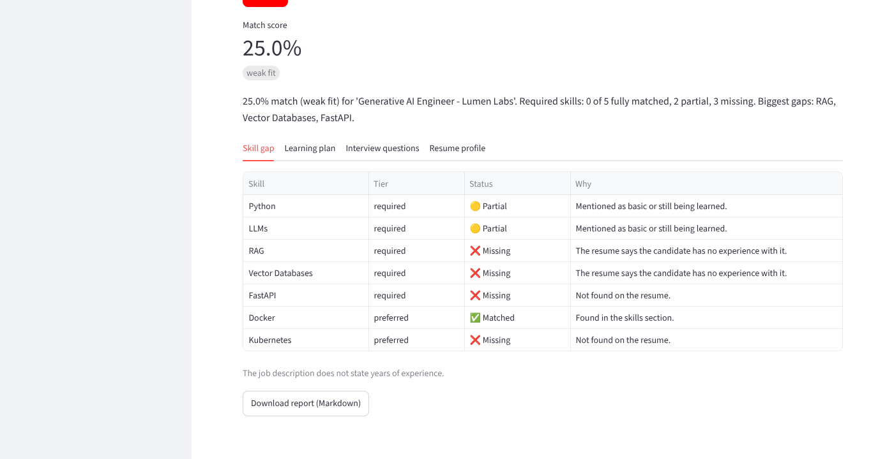

# AI-Powered Job Preparation Assistant

Compare a resume with a job description and get: a skill-gap table, a personalised learning plan, and interview questions, each with a reason. Works offline; Claude can optionally write the advice, but only about facts the code found.



## Quick start
```bash
python -m venv .venv
.venv\Scripts\activate          # Windows (macOS/Linux: source .venv/bin/activate)
pip install -r requirements.txt
streamlit run app.py             # web app
python -m jobprep demo --case 03 # CLI on a built-in sample
python -m jobprep analyze samples/resume_04.pdf samples/jd_04.txt --out out/
python -m jobprep evaluate
python -m jobprep ablation
python -m pytest -q
```
Optional Claude advice: set `ANTHROPIC_API_KEY` and use `--mode llm` (or pick "llm" in the app).

## How it works
Architecture diagram and requirements: [docs/REQUIREMENTS_AND_ARCHITECTURE.md](docs/REQUIREMENTS_AND_ARCHITECTURE.md).
Key ideas: a 64-skill knowledge base with aliases (k8s), implied skills (pandas implies Python) and related skills (AWS gives half credit for Azure); section-aware job parsing; negation and "learning" cues; PII redaction.

## Results (9 hand-labelled pairs, labels written before running)
| Metric | Score |
|---|---|
| Resume skill F1 | 0.994 |
| Job skill F1 | 1.000 |
| Gap status accuracy | 0.986 |
| Fit band accuracy | 1.000 |

Ablation (one feature off at a time):

| Variant | Resume F1 | Job F1 | Gap accuracy | Fit accuracy |
|---|---|---|---|---|
| full system | 0.994 | 1.0 | 0.986 | 1.0 |
| no aliases | 0.9 | 0.993 | 0.833 | 0.778 |
| no implied skills | 0.994 | 1.0 | 0.972 | 0.889 |
| no related-skill credit | 0.994 | 1.0 | 0.931 | 1.0 |
| no JD sections | 0.994 | 0.671 | 0.986 | 0.889 |
| no negation / partial cues | 0.972 | 1.0 | 0.861 | 0.778 |

**Be sceptical of these numbers.** The test set is small and written by the author. The first six pairs scored 1.0, so three harder stress cases were added; they exposed five bugs (fixed) and one failure that remains. See [docs/FAILURES.md](docs/FAILURES.md).

## Layout
`jobprep/` code, `samples/` 9 resume/job pairs with `labels.json`, `reports/` generated outputs, `tests/`, `docs/`.
LLM mode has been tested with a fake client only, not against the live API.
