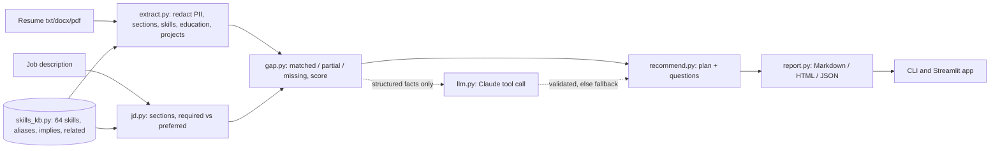

# Requirements and architecture (Day 26)

## Users and use cases
| User | Need |
|---|---|
| Job seeker / fresher | See honestly how well a resume fits one job, and what to learn first |
| Career changer | Know which existing skills transfer (implied and related skills) |
| Mentor / placement cell | Read a clear, explainable report without trusting a black box |

## Features
1. **Resume analysis**: text from txt, docx, pdf; skills, education, projects, years of experience; personal data redacted.
2. **Job description analysis**: required vs preferred skills, ignoring company-background text.
3. **Skill gap analysis**: matched, partial, missing per skill, with a reason; weighted score and fit band.
4. **Learning recommendations**: up to 6 prioritised steps with weeks, topics and a proof project.
5. **Interview questions**: probes on the resume, technical, gap and behavioural questions, each with a "why".

## Non-functional requirements
Works offline with no API key; every claim can be traced to a line in the resume; the optional Claude layer can never invent a gap or a skill; clear error on empty input or scanned PDF.

## Architecture

Design rule: **code finds the facts, AI explains them.** Claude receives only the structured gap result (never the resume text), answers through a forced JSON tool call, and `validate()` drops any plan item or question that the facts do not support.

## Scoring
Weights: required 1.0, preferred 0.5. Credit: matched 1.0, partial 0.5, missing 0. Related skills (for example AWS for Azure) give partial credit. Score = earned / possible. Fit: at least 75 strong, at least 50 moderate, otherwise weak.
